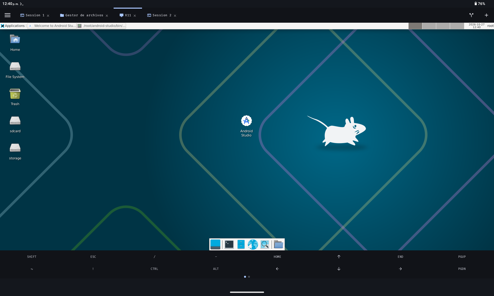
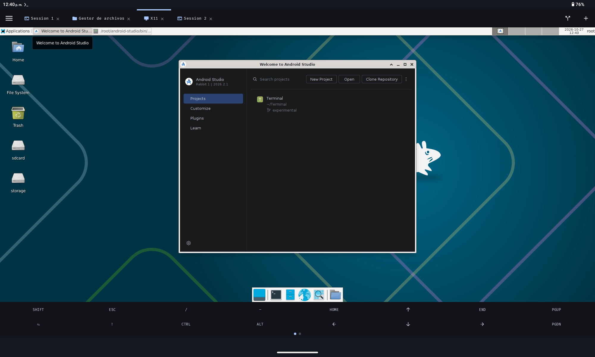
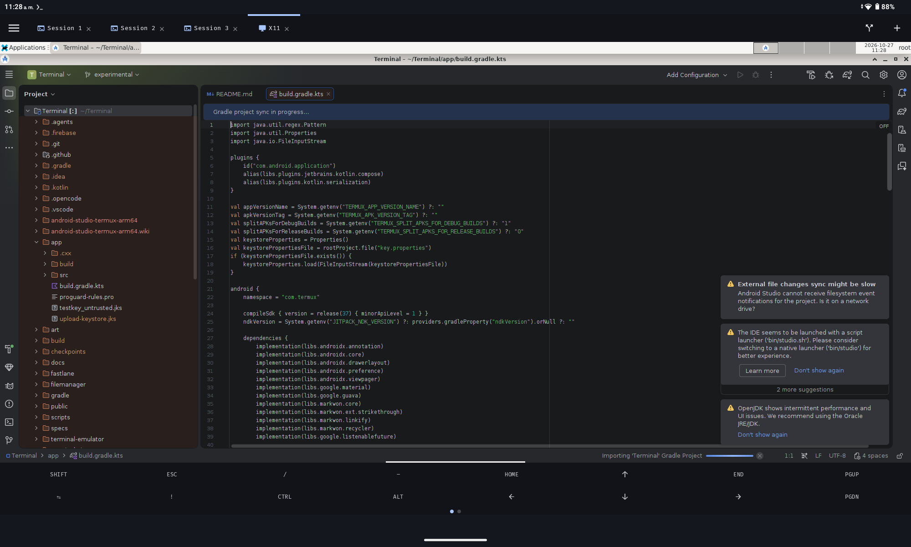

# Android-Studio-terminal-arm64

## 🌟 Introducción

Correr **Android Studio** en dispositivos móviles ha sido durante mucho tiempo un desafío debido a las limitaciones de arquitectura (**ARM64**) y la falta de soporte oficial para Linux en Android.

Este repositorio ofrece una solución probada para ejecutar el IDE de Android dentro del **guest Debian de la app [Terminal](https://github.com/ESTRIN217/Terminal)** (PRoot sin root), utilizando un enfoque "híbrido": librerías nativas ARM64 de **IntelliJ IDEA Community** sobre Android Studio, más un parche de skiko de Maven Central para las versiones 2026+.

### ✨ ¿Qué hace especial a esta guía?
* **Compatibilidad Real:** Soluciona los errores de binarios x86_64 en procesadores ARM.
* **Verificada (octubre de 2026):** Probada con Android Studio Rabbit 1 (2026.2.1), IDEA Community 2025.3 aarch64, OpenJDK 25 del guest y 5 GB de RAM.
* **Parche skiko obligatorio:** Con Android Studio ≥ 2026, los natives de IDEA Community (línea 253) son antiguos; el IDE arranca solo sustituyendo `libskiko-linux-arm64.so` por la versión exacta de Maven Central (lo hace el script por ti).
* **Automatización:** Script de parcheo en segundos.
* **Optimización:** Consejos de memoria RAM en entornos limitados.

# [Wiki](https://github.com/ESTRIN217/Android-Studio-terminal-arm64/wiki)

# [🚀 Instalación y Configuración](https://github.com/ESTRIN217/Android-Studio-terminal-arm64/blob/main/Instalaci%C3%B3n%20y%20Configuraci%C3%B3n.md)

# Capturas de pantalla

<table align="center">
  <tr>
    <td align="center">
      
    </td>
    <td align="center">
      
    </td>
  </tr>
  <tr>
        <td align="center">
      
    </td>
  </tr>
</table>

# 🤝 Créditos y Referencias
Android Studio: Google [developer.android.com](https://developer.android.com/studio?hl=es-419)

IntelliJ IDEA: JetBrains [jetbrains.com](https://www.jetbrains.com/idea/download/?section=linux)

Adaptación ARM64 original: Comunidad de Termux y HomuHomu833

Parche skiko para la línea 2026: verificado con la [wiki de Terminal](https://terminal-gnulinux-docs.web.app/android-studio.html)

---

# ⚖️ Descargo de Responsabilidad (Disclaimer)

[!CAUTION]
Uso bajo su propio riesgo: Este proyecto es una guía comunitaria y no oficial. El autor no se hace responsable de cualquier pérdida de datos, daños en el hardware o problemas de software derivados del seguimiento de estas instrucciones.

Notas sobre marcas registradas:

Android Studio es una marca registrada de Google LLC.

IntelliJ IDEA es una marca registrada de JetBrains s.r.o.

Este repositorio no está afiliado, patrocinado ni respaldado por Google, JetBrains ni ninguna de sus subsidiarias, ni por el equipo de Termux.

El uso de los binarios de IntelliJ IDEA para parchear Android Studio se realiza con fines de interoperabilidad en arquitecturas ARM64 no soportadas oficialmente. El usuario es responsable de cumplir con los Términos de Servicio de Android Studio.

---
## ⚖️ Licencia

Este proyecto está bajo la Licencia **Apache 2.0**. Puedes usar, estudiar, modificar y distribuir este material libremente, siempre que se mantenga el aviso de derechos de autor original.

Para más detalles, consulta el archivo [LICENSE](LICENSE) adjunto en este repositorio.

  Desarrollado con pasión por <b>ESTRIN217</b>.

  Hecho con ❤️ en Venezuela.

